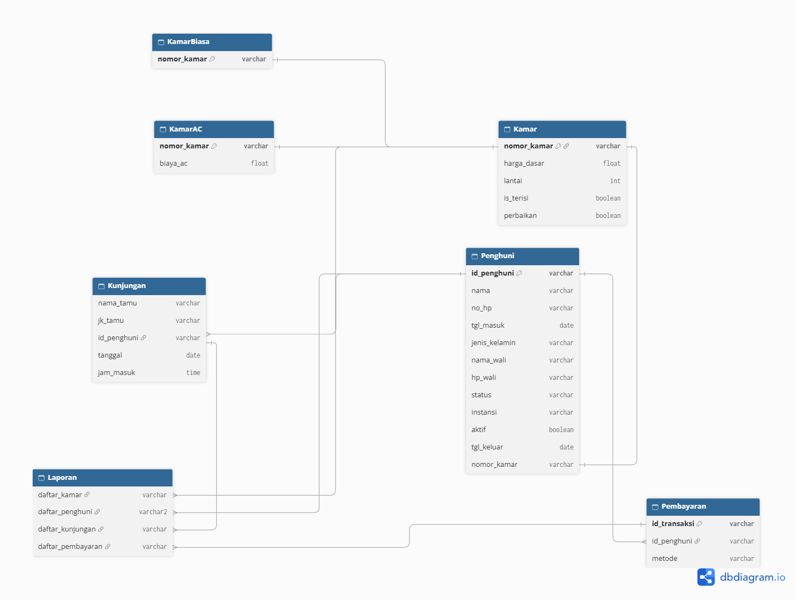

# Sistem Manajemen Kost Putri

Aplikasi ini merupakan sistem manajemen kost putri berbasis Python dan Streamlit untuk mengelola data kamar, penghuni, pembayaran, buku tamu, serta laporan harian. Aplikasi ini dibuat untuk mempermudah operasional kost putri dengan fitur utama seperti pendataan penghuni, pengecekan status kamar, pencatatan pengunjung, dan rekapan pemasukan.

## Fitur utama

- Manajemen data kamar dan status kamar
- Pendaftaran penghuni baru
- Pembayaran bulanan dengan perhitungan denda jika terlambat
- Pencatatan tamu / kunjungan
- Dashboard dan laporan rekapitulasi
- Simpan data ke file lokal dan AppSheet agar data tetap tersimpan saat aplikasi dibuka kembali

## Arsitektur dan UML




## Penjelasan singkat

- `Kamar` adalah kelas dasar untuk semua tipe kamar. Di sini terdapat status kamar, tarif dasar, dan perilaku umum seperti pengecekan ketersediaan.
- `KamarBiasa` dan `KamarAC` merupakan bentuk spesifik dari kamar dengan fasilitas yang berbeda dan harga yang berbeda pula.
- `Penghuni` menyimpan data penghuni, termasuk wali, tanggal masuk, status, dan kamar yang ditempati.
- `Pembayaran` menghitung tagihan bulanan dan denda keterlambatan serta menyimpan histori transaksi.
- `Kunjungan` menangani tamu yang datang ke kos dan membatasi jam kunjungan sesuai aturan.
- `Laporan` bertugas merangkum data untuk dashboard, laporan keluaran bulanan, dan monitoring penunggak.
- `KosService` berfungsi sebagai pusat pengelolaan, menghubungkan data kamar, penghuni, kunjungan, dan pembayaran ke antarmuka aplikasi.

## Struktur file utama

- `app.py` : antarmuka web menggunakan Streamlit
- `kos_service.py` : logika inti aplikasi yang nantinya di gunakan untuk penyimpanan data
- `kamar.py` : definisi kelas kamar
- `penghuni.py` : definisi data penghuni
- `pembayaran.py` : logika tagihan dan transaksi
- `kunjungan.py` : pencatatan tamu
- `laporan.py` : fungsi rekap dan laporan
- `exceptions.py` : custom exception untuk validasi dan error handling

## Logbook

- [Logbook Proyek](https://drive.google.com/drive/folders/1eB_Q0BrB8ZxKTqegmIPFkHJfz7vwbUBP)

## Cara menjalankan

1. Instal dependency:
   ```bash
   pip install -r requirements.txt
   ```
2. Jalankan aplikasi:
   ```bash
   streamlit run app.py
   ```
